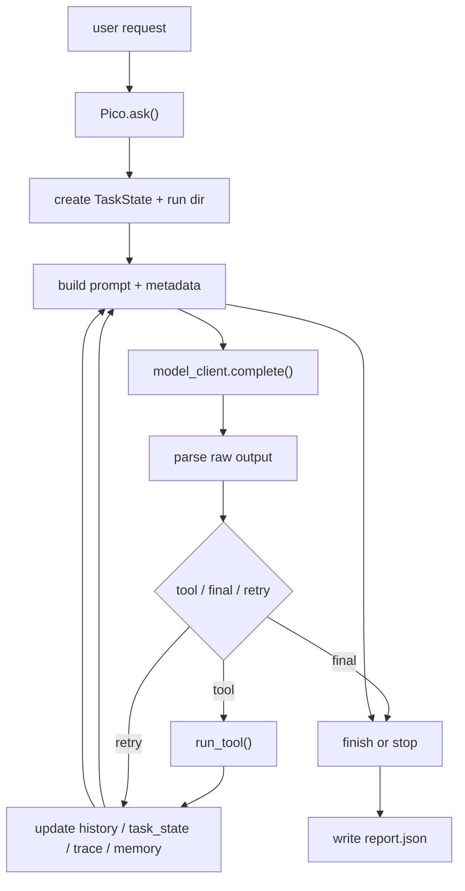

## 背景
如果只看 `tools.py`、`memory.py`、`context_manager.py` 这些模块，很容易把项目理解成几个零散能力的组合。真实运行时不是这么工作的。用户给一句话之后，系统要先建状态、再组 prompt、再调模型、再接工具、再落工件、最后决定什么时候停。把这些动作串起来的，就是主循环。

对面试来说，这一层很关键。因为很多人能讲清工具、能讲清 memory、也能讲清 prompt，但一问到一句请求进来以后系统到底怎么往前推，就开始散。

这篇的任务，就是把这条执行线讲清楚。

## 这篇要解决什么问题
问题可以压成一句话：

**一条用户请求，怎么被 runtime 推进成一次有边界、有状态、可回放的 agent 执行。**

这里面有五个子问题：

+ 这轮请求什么时候算真正开始
+ 模型一轮一轮是怎么被调起来的
+ 模型说要调工具以后，runtime 怎么接住
+ 执行过程中哪些状态会持续更新
+ 什么情况下继续跑，什么情况下停

## 从一句话到一次 run
`Pico` 对一次请求的处理单位，是一轮独立运行。

CLI 在 `pico/cli.py` 里先把现场装好，包括：

+ 用哪个 provider
+ 用哪个 model
+ 当前工作区是什么
+ session 是新开还是恢复
+ 高风险工具怎么审批
+ 最多允许跑几步

这些东西定完以后，运行权就交给 `agent.ask(user_message)`。

从 runtime 的视角看，一次请求会走下面这条线：



这张图需要注意两个地方。

第一，`ask()` 不只是调模型，它是在驱动一条完整执行链。

第二，工具执行并没有把控制流带出 runtime，结果还会重新回到状态里，再进入下一轮。

## ask() 一开始先做什么
`pico/runtime.py` 里的 `ask()`，开头先立运行现场，再进入推理和执行。

它会按顺序做这些事：

1. 把当前请求写进 `task_summary`
2. 把用户消息记进 session history
3. 创建 `TaskState`
4. 在 `.pico/runs/<run_id>/` 下创建本轮 run 目录
5. 立刻写出第一版 `task_state.json`
6. 追加一条 `run_started` trace

代码骨架大概就是这样：

```python
def ask(self, user_message):
    # [1] 把当前请求写进 memory 的任务摘要，供后续 prompt 组装时引用
    self.memory.set_task_summary(user_message)
    # [2] 把用户消息记进 session 历史，history 会在每轮 prompt 里投影给模型
    self.record({"role": "user", "content": user_message, "created_at": now()})

    # [3] 创建本轮 TaskState——绑定唯一的 run_id 和 task_id，一次请求 = 一次独立 run
    task_state = TaskState.create(
        run_id=self.new_run_id(),
        task_id=self.new_task_id(),
        user_request=user_message,
    )
    # [4] 挂到 runtime 上，后续主循环随时读写
    self.current_task_state = task_state
    # [5] 在 .pico/runs/<run_id>/ 下创建本轮 run 目录
    self.current_run_dir = self.run_store.start_run(task_state)
    # [6] 追加第一条 trace 事件，标记 run 正式开始
    self.emit_trace(task_state, "run_started", {...})
```

这个设计把一次请求和一次 run 绑定死了。

后面你查问题、做实验、回放 trace，都不需要再从一整段 session history 里猜边界。

## 主循环到底在循环什么（重要）
`ask()` 的 while 循环可以压成四个阶段：

+ **感知**：把当前状态重新整理成 prompt
+ **决策**：调模型，拿回一轮输出
+ **落地**：如果模型要调工具，就执行工具
+ **记录**：把这轮发生的事写回状态和工件

核心骨架可以看这一段：

```python
# 循环两个退出条件：工具步数用尽 或 重试次数用尽
while tool_steps < self.max_steps and attempts < max_attempts:
    attempts += 1                          # 本轮模型调用计数 +1
    task_state.record_attempt()            # 把 attempt 计数落进 TaskState
    self.run_store.write_task_state(task_state)  # 写出 task_state.json，让外部看到"跑到第几轮了"

    # --- 阶段一 · 感知：把当前状态（history + memory + workspace）投影成 prompt ---
    prompt, prompt_metadata = self._build_prompt_and_metadata(user_message)

    # --- 阶段二 · 决策：调模型，拿回一轮原始文本 ---
    raw = self.model_client.complete(prompt, self.max_new_tokens, ...)

    # --- 阶段三 · 落地：把文本拆成动作类型（tool / final / retry）---
    kind, payload = self.parse(raw)

    # 分支 A：模型要调工具
    if kind == "tool":
        task_state.record_tool(name)           # 记录本次工具调用
        result = self.run_tool(name, args)     # 统一过 run_tool 闸口（校验 + 审批 + 执行）
        self.record({...})                     # 工具结果写回 session history
        self.emit_trace(task_state, "tool_executed", {...})  # 留 trace 事件
        continue                               # 回到循环顶部，下一轮 prompt 会带上工具结果

    # 分支 B：模型输出格式不合法，通知它重试
    if kind == "retry":
        self.record({...})                     # 把重试提示写进 history
        continue                               # 回到循环顶部，不做任何工具动作

    # 分支 C：模型给出最终答案
    task_state.finish_success(final)            # 状态置为 completed，写明 stop_reason
    self.run_store.write_report(task_state, self.build_report(task_state))  # 写出 report.json
    return final                               # 控制流到此结束，本轮 run 终止
```

这里有两个状态字段要注意：

+ `attempts` 统计模型被调了多少轮
+ `tool_steps` 统计真正进入执行阶段的工具调用次数

一个任务 attempts 很高但 tool_steps 很低，通常是模型输出格式不好或者一直在 retry。

tool_steps 很高，说明它真的在执行很多动作。

## 为什么 prompt 每轮都要重建
runtime 每轮都会重新走 `_build_prompt_and_metadata()`。

主要原因是，下面几个东西每一轮都可能变：

+ **history**：`session["history"]` 里的完整对话流水（用户消息 + 模型回答 + 工具调用结果），每轮工具执行完都会追加新记录，所以上一轮的内容和下一轮不一样
+ **memory**：`LayeredMemory` 里的轻量工作集（当前任务摘要、最近接触的文件、文件短摘要、跨轮笔记），工具执行可能触发文件摘要更新或旧摘要失效，不是所有工具结果都进 memory
+ **workspace 状态**：当前仓库的文件结构、Git 最近提交、项目文档等事实摘要，如果工具执行改了文件（`write_file` / `patch_file`），下一轮 workspace 指纹就会变，触发 prefix 重建
+ **工具数和 prefix 状态**：可用工具列表是否变化，以及 prefix 的 hash / workspace_fingerprint / tool_signature 是否改变——这些决定了 prompt 前缀是否走缓存还是重建
+ **当前请求对应的相关上下文**：`ContextManager` 根据 memory 和 checkpoint 选出的、与当前请求最相关的上下文片段（相关记忆、检查点信息等），每次请求不同，选出来的内容也不同

所以 prompt 在 runtime 里不是一份固定文本，更像当前执行状态的投影。`_build_prompt_and_metadata()` 除了组 prompt，还会顺手带出一份 metadata，里面会记：

+ prefix 长度
+ workspace 长度
+ history 长度
+ tool 数量
+ prefix hash
+ workspace fingerprint
+ prompt cache key

这些元数据对主循环很重要，后面 trace、report、实验聚合都要靠它们解释这一轮 prompt 到底发生了什么。

## 模型输出怎么进入控制流
模型返回的是文本，runtime 需要的是动作。中间这一步由 `parse()` 来做。

`parse()` 会把一轮模型输出压成三类结果：

+ `tool`
+ `final`
+ `retry`

它支持两类工具调用格式：

+ `<tool>...</tool>` 里包 JSON
+ XML 风格 `<tool name="...">...</tool>`

核心逻辑可以直接看这一段：

```python
# parse() 是模型文本到运行时动作的翻译器，输出只有三类：tool / final / retry

# 格式1：<tool>...</tool> 内包 JSON，适合简短的工具调用
if "<tool>" in raw:
    payload = json.loads(body)      # 从 <tool> 标签里取出 JSON 并解析
    return "tool", payload          # 返回动作类型 + 工具名和参数

# 格式2：XML 风格 <tool name="...">...</tool>，适合写文件等多行内容
if "<tool" in raw:
    payload = Pico.parse_xml_tool(raw)  # 解析 XML 属性 + 子标签
    if payload is not None:
        return "tool", payload

# 模型显式写了 <final>，说明它认为任务已完成
if "<final>" in raw:
    return "final", final

# 没有标签但有内容，就当它是纯文本最终答案
if raw.strip():
    return "final", raw.strip()

# 什么都没有——空响应，让模型重试
return "retry", Pico.retry_notice(...)
```

模型说了什么不重要，runtime 关心的是接下来该走哪条分支。

## 工具调用怎么重新接回主循环
当 `parse()` 返回 `tool` 之后，主循环不会直接跳到具体工具函数，而是统一先走 `run_tool()`。

`run_tool()` 负责把执行前后的关键动作串起来：

1. 检查工具是不是已注册
2. 校验参数是否合法
3. 判断是不是连续重复调用
4. 高风险工具走审批
5. 真正执行工具
6. 把结果裁剪后返回
7. 更新 memory 里的局部事实

工具执行没有脱离主循环。工具结果回来以后，会继续写回这些状态：

+ session history
+ `TaskState`
+ trace
+ report 使用的最后一轮 metadata
+ memory 里的轻量事实

这样 runtime 才能在下一轮继续推进，而不是每次工具调用都像一条临时岔路。

## TaskState 为什么是主循环的中心状态
`pico/task_state.py` 里的 `TaskState` 很值得单独讲，因为它把这轮运行的中心状态收在了一个地方。

它主要记录这些字段：

+ `run_id`
+ `task_id`
+ `status`
+ `tool_steps`
+ `attempts`
+ `last_tool`
+ `stop_reason`
+ `final_answer`

这里最值钱的设计是 `status` 和 `stop_reason` 分开存。

`status` 回答的是这轮现在是什么状态，比如 `running`、`completed`、`stopped`、`failed`。  
`stop_reason` 回答的是它为什么停，比如 `final_answer_returned`、`step_limit_reached`、`retry_limit_reached`。

这两个维度分开以后，后面做 benchmark 和失败归因时，就不会把所有停机都混成一个模糊的失败。

## RunStore 为什么要跟主循环绑在一起
如果主循环只返回一个最终答案，很多工程问题都没法解释。

`Pico` 这里把工件落盘直接绑进主循环，靠的是 `RunStore`。

每次 run 至少会写三类工件：

+ `task_state.json`
+ `trace.jsonl`
+ `report.json`

这三类工件分工很清楚。

+ `task_state.json` 负责看当前这轮跑到哪了
+ `trace.jsonl` 负责看过程里发生了什么
+ `report.json` 负责看最后结果和关键指标

这也是为什么 `ask()` 看上去比普通 demo agent 重一点。它不是只求跑通，还要把每一步都留证据。

## 循环什么时候停
当前主循环的停止条件很清楚，主要有三类。

### 一，模型给出最终答案
这时 `task_state.finish_success(final)`，状态会进入 `completed`，然后写 report，函数直接返回。

### 二，达到工具步数上限
这时 runtime 会返回一条停止说明，并把 `stop_reason` 记成 `step_limit_reached`。

### 三，达到重试上限
这一般意味着模型连续多轮输出了坏格式、空响应或者没法进入有效动作。

runtime 会把它记成 `retry_limit_reached`。

在面试的时候你可以这么说：runtime 关心的不只是成功路径，也关心怎么有边界地停下来。

## 当前设计的trade-off
这一版 runtime 很克制，它减少了不少复杂度。

### 减少了 planner 和多级调度
当前主循环就是单循环，没有额外 planner，也没有复杂 phase machine。

这样做的好处是调试简单，控制流清楚，trace 也更容易看。

### 减少了花哨编排
工具调用、模型调用、状态回写都还在一个明确的总调度器里。

复杂度集中，坏处是 `ask()` 会显得比较重，好处是主链路很完整。

### 换来了可回放和可解释
`prompt_metadata`、`TaskState`、`trace`、`report` 这些东西都让代码更厚，但这部分厚度换来了 runtime 级别的解释能力。你可以说清楚这轮为什么停、调了几次模型、用了几步工具、最后留下了什么证据。

对一个本地 coding harness 来说，这个取舍是合理的。主循环先做稳，后面别的能力才有地方挂。

## 对于runtime，还有什么能改进的地方，如果继续开发的话
我会优先补三件事。

### 一，细化失败类别
这里要解决的，不只是给异常起更多名字，而是让 runtime 能回答三个问题：**哪里出了问题、接下来怎么处理、这次问题最终有没有导致整个 run 停止。**

#### 1. 先区分动作类型、单步错误和运行结果

当前代码里的几个字段处于不同层次，不能混为一谈：

| 层次 | 当前字段或返回值 | 回答的问题 |
|---|---|---|
| 模型输出的解析结果 | `kind = tool / final / retry` | 这次输出应该进入哪个分支？ |
| 一次工具调用的结果 | `tool_status`、`tool_error_code` | 工具被拒绝、执行失败，还是已经改动了一部分文件？ |
| 整个 run 的当前状态 | `TaskState.status` | 这次运行还在进行、已经完成、受限停止，还是失败？ |
| 整个 run 的停止原因 | `TaskState.stop_reason` | 最后为什么停下来？ |

例如，`kind="tool"` 只表示解析器认出了工具调用。工具名可能不存在，参数也可能不合法，还需要经过 `ToolExecutor.execute()` 的校验。`kind="retry"` 则表示解析器要求模型重新输出，不代表网络请求失败。

同样，某一次工具调用失败，不一定意味着整个任务失败。模型可以根据错误换参数、换工具，最后仍然给出最终答案。因此，**单步错误应作为事件保留，run 的最终状态应单独记录。**

#### 2. 当前代码已经处理了哪些情况

下面描述的是现有实现，而不是后续计划：

| 失败或异常情况 | 当前如何识别 | 当前处理方式 |
|---|---|---|
| 模型返回空内容 | `Pico.parse()` 发现空字符串或纯空白 | 返回 `retry`，写入纠错提示，再调用模型 |
| 工具输出格式错误 | JSON 无法解析、不是对象、缺少有效 `name`、`args` 类型错误，或 XML 风格调用无法解析 | 返回 `retry`，让模型重新输出 |
| 最终答案为空 | `<final>` 中没有有效内容 | 返回 `retry` |
| 模型后端调用异常 | `model_client.complete()` 抛出异常 | `_request_model()` 记录 `model_failed`；在落盘成功的情况下写入失败状态、检查点和报告，然后继续向外抛出异常；run 的状态为 `failed`，停止原因为 `model_error` |
| 工具不存在或不在允许列表中 | 工具注册表或允许列表检查失败 | 返回工具错误，错误码为 `unknown_tool` 或 `tool_not_allowed`；主循环继续，让模型根据反馈调整 |
| 工具参数不合法 | `validate_tool()` 校验失败 | 返回 `invalid_arguments`；路径越界还会记录 `security_event_type="path_escape"` |
| 重复调用无效工具动作 | 最近两条工具记录与当前工具名、参数都相同 | 拒绝本次调用，记录 `repeated_identical_call`，要求换一种做法 |
| 高风险操作未获批准 | `approve()` 返回假 | 返回 `approval_denied`；只读模式阻止操作时还会记录 `read_only_block`；当前主循环不会因此立即结束整个 run |
| 工具执行出错且没有检测到文件变化 | 工具抛异常，或 `run_shell` 返回非零退出码 | 通常记录 `tool_status="error"`、`tool_error_code="tool_failed"`，把结果交给模型继续处理 |
| 工具执行出错但已经检测到文件变化 | 执行异常或命令非零退出，同时快照发现文件改动 | 记录 `partial_success`、`tool_partial_success`、受影响路径和变更摘要，提醒后续先检查现场 |
| 主循环模型调用次数达到上限 | `attempts >= max_attempts`，且工具步数尚未用尽 | 状态设为 `stopped`，停止原因为 `retry_limit_reached` |
| 工具步数用尽 | `tool_steps >= max_steps` | 额外请求一次模型做最终总结；能得到最终答案就完成，否则以 `step_limit_reached` 停止 |

还有两个边界容易误解：

+ **无标签的普通非空文本，当前会被当作 `final` 接受。** 因此，“没有按要求写 `<final>`”并不一定触发格式重试；当前解析器也没有严格保证输出中只能出现一个完整标签块。
+ **拿到 `final` 只表示控制流程正常结束。** 当前 `finish_success()` 会把状态设为 `completed`，但它不等于测试已经通过，也不等于用户要求的功能经过独立验证。任务效果仍需要测试或评测判断。

`task_state.py` 还定义了 `tool_timeout`、`approval_denied`、`delegate_failed`、`persistence_error`、`resume_load_error` 等停止原因常量，但它们目前没有全部接入主流程。**定义了常量，不代表对应失败已经有专门的停机和落盘分支。** 例如工具超时目前通常进入通用工具异常处理；子 agent 异常传播到父工具时，也可能被归入通用的 `tool_failed`。

#### 3. 三种“再试一次”需要分开理解

**第一种是输出格式重试。** 模型已经返回文本，但 `parse()` 无法把它转换成有效动作，于是写入 `retry_notice()`，重新组 prompt，再问模型一次。

```text
模型返回坏 JSON
  → parse() 返回 retry
  → 将“请返回合法工具调用或非空最终答案”写入 history
  → 再次调用模型
```

这种重试增加 `attempts`，不会增加 `tool_steps`。

**第二种是后端请求重试。** 这是 provider 客户端内部的 HTTP 重试。当前 OpenAI-compatible 和 Anthropic-compatible 客户端对部分连接异常、HTTP 5xx 最多尝试三次；并非所有后端或所有异常都有同样策略。它们重发的是同一次模型请求，不会生成一条格式纠错提示。若最终仍抛异常，runtime 会按 `model_error` 处理。

客户端内部的多次 HTTP 请求，主循环仍只计为一次 `attempt`。因此，主循环的 `attempts` 不等于实际 HTTP 请求总次数。

**第三种是工具失败后的调整。** 输出已经解析为 `tool`，但工具校验或执行失败。错误作为工具结果写入 history，模型下一轮可以修改参数、检查现场或换工具。这一轮走的是工具分支，不是解析器的 `retry` 分支。当前 `tool_steps` 在进入工具执行器之前就增加，所以即使调用被拒绝，也会消耗工具步数。

另外，当前重试上限实际上是主循环模型调用的**总次数上限**：

```python
max_attempts = max(agent.max_steps * 3, agent.max_steps + 4)
```

例如 `max_steps=6` 时，主循环最多调用模型 18 次。`attempts` 包含有效工具调用对应的模型轮次，也包含格式错误轮次；成功解析一次不会把它清零。因此，`retry_limit_reached` 不一定意味着“连续 18 次格式错误”。工具预算用尽后的那次最终总结调用，则在主循环之外额外进行。

#### 4. 后续建议如何继续细分

当前工具侧已经有部分结构化错误码，后续可以沿用这一方式，把模型解析、后端通信、状态保存等环节也统一起来。下面的类别是**建议补充的设计，不是现有字段清单**：

| 失败阶段 | 建议细分的类别 | 处理原则 |
|---|---|---|
| 模型输出解析 | 空响应、工具 JSON 错误、缺少字段、参数类型错误、空最终答案 | 带具体原因和正确示例，让模型在有限次数内修正 |
| 模型后端通信 | 连接失败、请求超时、限流、服务端异常、认证失败、请求配置错误 | 对允许重试的暂时性错误做有上限的退避重试；认证和配置错误应直接报告，避免反复请求 |
| 工具校验与审批 | 未知工具、参数错误、目录越界、只读限制、用户拒绝 | 保留明确拒绝原因；不能通过自动重试绕过约束；是否结束整个 run 需要单独规定 |
| 工具执行 | 文件不存在、命令非零退出、工具超时、部分执行成功 | 区分“可以换参数再做”和“先检查已有副作用”；不能一律原样重放 |
| 子 agent 执行 | 子任务失败、子任务步数用尽、子任务返回了无法使用的结果 | 关联父子 run，保留子任务原因，再由父任务决定继续还是停止 |
| 持久化与恢复 | session 保存失败、trace/report 写入失败、检查点损坏或不兼容 | 明确哪些状态已经保存、哪些没有；不能默认恢复成功或报告已完整写入 |
| 预算与控制循环 | 工具步数用尽、模型总调用次数用尽、格式纠错次数用尽 | 分别计数和记录，避免用同一个 `retry_limit_reached` 掩盖不同原因 |

特别是“部分执行成功”需要单独保留。比如一条命令先修改了文件，随后测试失败，直接原样重跑可能重复修改现场；下一步应该先检查变更，再决定补救动作。

#### 5. 错误事件应该记录哪些信息

建议给每次错误增加统一的结构化记录，而不仅仅写一段报错文本。例如下面是一条**拟议的解析失败事件**：

```json
{
  "run_id": "run_example",
  "task_id": "task_example",
  "attempt": 3,
  "phase": "parse_model_output",
  "error_code": "malformed_tool_json",
  "message": "工具调用中的 JSON 无法解析",
  "recovery_action": "ask_model_to_reformat",
  "will_retry": true,
  "terminal": false
}
```

这里把 `recovery_action` 和 `terminal` 分开，是因为“下一步如何恢复”和“整个 run 是否结束”不是同一件事。`will_retry` 也应结合剩余预算决定，而不是某类错误永远重试。

原始输出只保留排错所需、经过脱敏和长度限制的片段；工具错误还应关联工具名、受影响文件，以及是否发生了部分改动。`trace.jsonl` 保存每次错误事件，`report.json` 汇总各类错误数量和最终停止原因。

这样可以保留两种不同结论：一个 run 可能经历了两次格式错误和一次工具失败，最终仍然完成；也可能没有格式错误，却因为后端服务异常而失败。

#### 6. 可以先落地的最小改进

+ 让解析结果除了 `kind`、`payload`，还能携带明确的错误码，避免只靠纠错提示文本做统计。
+ 将模型后端异常细分，沿用工具侧已有的结构化错误记录方式。
+ 分别统计模型总调用次数、格式纠错次数和客户端 HTTP 重试次数。
+ 明确每类错误的恢复动作、预算以及是否终止整个 run。
+ 验证空响应、坏 JSON、工具拒绝、部分文件改动、后端异常、预算耗尽和保存失败这些路径，并检查它们留下的 trace 与 report 是否一致。

面试时可以这样讲：当前已经有解析分支、工具错误元数据和运行停止原因，下一步要把它们连成完整的失败分类体系。目标是区分“可恢复的单步错误”和“导致整个 run 停止的错误”，再为每类错误选择合适的恢复策略，让报告和评测能够解释任务为什么失败、又是怎么恢复成功的。

### 二，补更显式的阶段字段
现在 trace 是事件序列，可读性已经够用。

如果以后想做可视化或复杂评测，runtime 可以再加一层统一的 phase 标记。

### 三，补父子 run 关系
这里要补的，是**把执行过程中已经存在的父子关系，明确保存到运行状态和日志里**，这样才能从父任务追踪到子任务，也能从子任务反查是谁发起的。

#### 1. 当前已经有父子 agent，但缺少明确的关联字段

模型可以调用 `delegate` 工具，把一项调查任务交给子 agent。调用链是：

```text
父 agent 返回 delegate 工具调用
  → tools.tool_delegate() 校验任务和委派深度
  → runtime.spawn_delegate() 创建新的 Pico 实例
  → child.ask(task) 执行子任务
  → 返回 "delegate_result:\n" + 子任务结果
  → 父 agent 把它当作工具结果写入 history，继续主循环
```

子 agent 复用模型客户端和仓库视图，拥有自己的 session；调用 `ask()` 时，也会生成自己的 `task_id`、`run_id` 和运行工件。它与父 agent 使用同一个 `RunStore`，所以各自的日志保存在同一个 `.pico/runs/` 根目录下的不同 run 目录里。

当前子 agent 被设为只读，工具步数默认是 3；默认 `max_depth=1`，子 agent 不再获得继续委派的 `delegate` 工具。这是同步执行：父 agent 要等 `child.ask()` 返回，才继续处理下一步，并没有并发调度。

但是，`TaskState` 目前没有 `parent_run_id` 等字段，父侧的 `delegate_result` 也主要是文本。`depth` 只能说明委派层数，不能说明“这个子 run 的父 run 到底是哪一个”。**复用同一个存储目录，并不等于已经保存了父子关系。**

#### 2. 缺少关联会带来哪些问题

+ **排错困难。** 父 run 的日志显示调用过 `delegate`，却没有直接指向对应子 run 的编号，需要人工结合时间和任务内容查找。
+ **结果容易被误读。** 子 agent 因步数用尽而返回停止说明时，父工具仍可能正常返回一段 `delegate_result` 文本；仅凭工具没有抛异常，不能认为子任务已经完成。
+ **失败原因容易被压平。** 子 agent 的模型请求异常如果向外抛出，父侧工具执行器可能只记录通用 `tool_failed`。需要关联子 run，才能找到更具体的 `model_error` 和后端错误信息。
+ **统计成本不完整。** 父侧把一次 `delegate` 计作一次工具调用，但子 agent 内部可能又调用多次模型和工具。只看父 run 的计数，无法直接得到整次委派的完整成本。
+ **恢复现场缺少依据。** 父 run 中断后，如果不知道子 run 是否已启动、是否已结束、结果保存在哪里，就难以判断应该复用结果、恢复子任务，还是重新发起委派。

#### 3. 建议增加哪些关联信息

下面是后续建议，当前代码还没有这些完整的关联字段：

| 字段 | 保存位置建议 | 作用 |
|---|---|---|
| `parent_run_id` | 子 run 的状态和报告 | 指向直接创建它的父 run；顶层 run 为空 |
| `delegation_id` | 父侧委派事件、子 run 的状态和报告 | 标识一次具体委派，区分同一父 run 发起的多次子任务 |
| `child_run_ids` 或子任务摘要列表 | 父 run 的报告 | 从父 run 直接找到各个子 run，查看状态和停止原因 |
| `root_run_id`（后续可选） | 多层委派的运行状态和报告 | 允许更深委派时，用于把整条执行链归到最初的顶层 run |

其中，`task_id` 仍然标识各自的任务，不需要让父子 agent 共用一个 `task_id`。按当前实现，父任务和子任务本来就各自创建任务编号；`parent_run_id` 负责表达这两次执行之间的关系。

第一版可以先实现 `parent_run_id`、`delegation_id` 和父报告中的子任务摘要，不必先引入复杂的调度树。

例如，未来父报告中的一条子任务摘要可以是：

```json
{
  "delegation_id": "delegate_001",
  "child_run_id": "run_child_001",
  "child_session_id": "session_child_001",
  "status": "stopped",
  "stop_reason": "step_limit_reached",
  "result": "已检查入口文件，但尚未完成全部调查"
}
```

这比只有一段 `delegate_result` 文本更容易判断：子任务确实返回了，但停止时没有完成全部调查。为了保持原来的工具接口，给模型阅读的文本仍然可以保留，同时在工具元数据中携带关联编号和子任务状态。

#### 4. 关系应该在生命周期中持续记录

建议新增明确的委派事件，事件名称可以是：

```text
父 run：delegation_created，先保存 delegation_id 和任务描述
  → 子 run 创建：保存 parent_run_id、delegation_id 和自己的 run_id
  → 父侧记录 delegation_started，关联 child_run_id
  → 子 run 持续写自己的 trace、状态和检查点
  → 父侧记录 delegation_finished 或 delegation_failed
  → 父报告保存子任务状态、停止原因和结果引用
```

关联信息应在子 run 创建时就落盘，而不是等子任务成功返回以后才补写。否则子任务中途异常时，最需要排查的那条父子关系反而可能丢失。

子 run 的状态和原始停止原因应该保留，父 run 再决定是否继续。例如，子任务失败后，父 agent 可以缩小调查范围、自己接手，或者向用户报告限制；子任务失败不必自动变成整个父任务失败。

#### 5. 第一版的实现边界

可以先保留当前同步、只读、默认单层委派的执行方式，只补关联字段、事件和结构化子任务结果。统计时分别给出父 run 自身计数与包含子 run 的汇总计数；父侧 `delegate` 的耗时已经包含等待子任务的时间，计算总耗时时要避免重复相加。

恢复机制则要再多走一步：关联到子 run 后，还需要读取其状态、结果和检查点，并验证是否适用于当前现场。仅仅有 `parent_run_id`，还不足以保证委派可以安全恢复。未确认子任务状态之前，也不应直接把整次委派重新执行一遍。

面试时可以这样讲：当前已经有通过 `delegate` 创建子 agent 的能力，但父侧主要把它当成一个返回文本的工具。下一步会把 `parent_run_id`、委派编号和子任务状态写入状态、trace 和报告，让父子任务可以双向追踪，并为失败归因、成本汇总和后续恢复提供依据。

## 面试里怎么讲runtime相关的内容
> Pico 的 runtime 主循环负责把一条用户请求推进成一次独立 run。`ask()` 开头先建 `TaskState`、run 目录和第一条 trace，然后每轮都重新组 prompt、调模型、解析输出。如果模型要调工具，统一先过 `run_tool()`，工具结果回来以后再写回 history、task state、trace 和 memory，继续下一轮。停机条件也很清楚，要么拿到 final answer，要么命中 step limit 或 retry limit。这样一轮请求从开始到结束都会留下工件和状态，不会只剩一句最后答案。
>

## 什么是"有状态、有边界、可回放"

文档反复提到这三个词，这里做一次集中拆解。

### 有状态

不是说 `status = "running"` 这么简单，而是**每一步的变化都被记录在案**：

```
用户一句话进来
  → TaskState 创建，attempts=0, tool_steps=0
  → 调模型，attempts=1
  → 调 list_files，tool_steps=1, last_tool="list_files"
  → 结果写进 history
  → 调模型，attempts=2
  → 调 read_file，tool_steps=2, last_tool="read_file"
  ...
  → finish_success，status="completed", stop_reason="final_answer_returned"
```

TaskState + session history 全程在变，每一步都落盘。你可以随时查"现在 tool_steps 到几了"，而不是最后只给一句答案。

### 有边界

**run 一定会在某个明确的条件下停下来**，不会无限循环：

| 停机条件 | 含义 |
|---|---|
| `final_answer_returned` | 模型给出最终答案 |
| `step_limit_reached` | 工具步数用尽 |
| `retry_limit_reached` | 模型连续多轮输出无效内容 |

没有"模型自由发挥、不知道什么时候结束"的情况。每一步执行都在 `while tool_steps < max_steps and attempts < max_attempts` 的硬边界里。

### 可回放

一次 run 结束后，不看模型输出，**只看磁盘上的文件就能完整还原全过程**：

```
trace.jsonl:
  run_started         → 用户说了什么，task_id 是什么
  prompt_built        → 这轮 prompt 多大、各 section 各占多少
  model_requested     → attempts=1, tool_steps=0
  model_parsed        → kind=tool，耗时 4077ms
  tool_executed       → list_files，耗时 15ms，返回了文件列表
  checkpoint_created  → checkpoint_id=ckpt_...
  ...
  run_finished        → status=completed，总耗时 20406ms
```

回放不需要重跑模型，不需要问"当时发生了什么"，翻 trace 就行。

---

## 总结
`Pico` 的运行时主循环，做的是把一句用户请求推进成一次有状态、有边界、可回放的执行——**不是黑盒魔术，你知道它每一步在做什么（有状态），你知道它什么时候会停（有边界），事后你能逐帧看录像（可回放）。**

这条主线把 prompt、model、tool、state、artifact 全部接到了同一个控制流里。前面的仓库基线、后面的工具治理、记忆系统、缓存和审计，最后都要挂在这条线上，整个 agent 才像一个真正能持续工作的 runtime。

