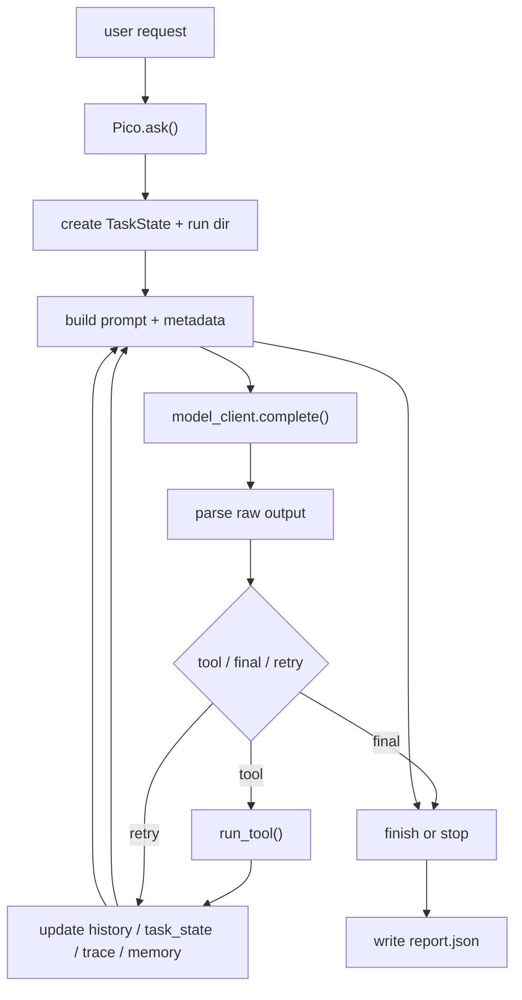

## 背景
如果只看 `tools.py`、`memory.py`、`context_manager.py` 这些模块，很容易把项目理解成几个零散能力的组合。真实运行时不是这么工作的。用户给一句话之后，系统要先建状态、再组 prompt、再调模型、再接工具、再落工件、最后决定什么时候停。把这些动作串起来的，就是主循环。

对面试来说，这一层很关键。因为很多人能讲清工具、能讲清 memory、也能讲清 prompt，但一问到一句请求进来以后系统到底怎么往前推，就开始散。

这篇的任务，就是把这条执行线讲清楚。

## 这篇要解决什么问题
问题可以压成一句话：

**一条用户请求，怎么被 runtime 推进成一次有边界、有状态、可回放的 agent 执行。**

这里面有五个子问题：

+ 这轮请求什么时候算真正开始
+ 模型一轮一轮是怎么被调起来的
+ 模型说要调工具以后，runtime 怎么接住
+ 执行过程中哪些状态会持续更新
+ 什么情况下继续跑，什么情况下停

## 从一句话到一次 run
`Pico` 对一次请求的处理单位，是一轮独立运行。

CLI 在 `pico/cli.py` 里先把现场装好，包括：

+ 用哪个 provider
+ 用哪个 model
+ 当前工作区是什么
+ session 是新开还是恢复
+ 高风险工具怎么审批
+ 最多允许跑几步

这些东西定完以后，运行权就交给 `agent.ask(user_message)`。

从 runtime 的视角看，一次请求会走下面这条线：



这张图需要注意两个地方。

第一，`ask()` 不只是调模型，它是在驱动一条完整执行链。

第二，工具执行并没有把控制流带出 runtime，结果还会重新回到状态里，再进入下一轮。

## ask() 一开始先做什么
`pico/runtime.py` 里的 `ask()`，开头先立运行现场，再进入推理和执行。

它会按顺序做这些事：

1. 把当前请求写进 `task_summary`
2. 把用户消息记进 session history
3. 创建 `TaskState`
4. 在 `.pico/runs/<run_id>/` 下创建本轮 run 目录
5. 立刻写出第一版 `task_state.json`
6. 追加一条 `run_started` trace

代码骨架大概就是这样：

```python
def ask(self, user_message):
    # [1] 把当前请求写进 memory 的任务摘要，供后续 prompt 组装时引用
    self.memory.set_task_summary(user_message)
    # [2] 把用户消息记进 session 历史，history 会在每轮 prompt 里投影给模型
    self.record({"role": "user", "content": user_message, "created_at": now()})

    # [3] 创建本轮 TaskState——绑定唯一的 run_id 和 task_id，一次请求 = 一次独立 run
    task_state = TaskState.create(
        run_id=self.new_run_id(),
        task_id=self.new_task_id(),
        user_request=user_message,
    )
    # [4] 挂到 runtime 上，后续主循环随时读写
    self.current_task_state = task_state
    # [5] 在 .pico/runs/<run_id>/ 下创建本轮 run 目录
    self.current_run_dir = self.run_store.start_run(task_state)
    # [6] 追加第一条 trace 事件，标记 run 正式开始
    self.emit_trace(task_state, "run_started", {...})
```

这个设计把一次请求和一次 run 绑定死了。

后面你查问题、做实验、回放 trace，都不需要再从一整段 session history 里猜边界。

## 主循环到底在循环什么（重要）
`ask()` 的 while 循环可以压成四个阶段：

+ **感知**：把当前状态重新整理成 prompt
+ **决策**：调模型，拿回一轮输出
+ **落地**：如果模型要调工具，就执行工具
+ **记录**：把这轮发生的事写回状态和工件

核心骨架可以看这一段：

```python
# 循环两个退出条件：工具步数用尽 或 重试次数用尽
while tool_steps < self.max_steps and attempts < max_attempts:
    attempts += 1                          # 本轮模型调用计数 +1
    task_state.record_attempt()            # 把 attempt 计数落进 TaskState
    self.run_store.write_task_state(task_state)  # 写出 task_state.json，让外部看到"跑到第几轮了"

    # --- 阶段一 · 感知：把当前状态（history + memory + workspace）投影成 prompt ---
    prompt, prompt_metadata = self._build_prompt_and_metadata(user_message)

    # --- 阶段二 · 决策：调模型，拿回一轮原始文本 ---
    raw = self.model_client.complete(prompt, self.max_new_tokens, ...)

    # --- 阶段三 · 落地：把文本拆成动作类型（tool / final / retry）---
    kind, payload = self.parse(raw)

    # 分支 A：模型要调工具
    if kind == "tool":
        task_state.record_tool(name)           # 记录本次工具调用
        result = self.run_tool(name, args)     # 统一过 run_tool 闸口（校验 + 审批 + 执行）
        self.record({...})                     # 工具结果写回 session history
        self.emit_trace(task_state, "tool_executed", {...})  # 留 trace 事件
        continue                               # 回到循环顶部，下一轮 prompt 会带上工具结果

    # 分支 B：模型输出格式不合法，通知它重试
    if kind == "retry":
        self.record({...})                     # 把重试提示写进 history
        continue                               # 回到循环顶部，不做任何工具动作

    # 分支 C：模型给出最终答案
    task_state.finish_success(final)            # 状态置为 completed，写明 stop_reason
    self.run_store.write_report(task_state, self.build_report(task_state))  # 写出 report.json
    return final                               # 控制流到此结束，本轮 run 终止
```

这里有两个状态字段要注意：

+ `attempts` 统计模型被调了多少轮
+ `tool_steps` 统计真正进入执行阶段的工具调用次数

一个任务 attempts 很高但 tool_steps 很低，通常是模型输出格式不好或者一直在 retry。

tool_steps 很高，说明它真的在执行很多动作。

## 为什么 prompt 每轮都要重建
runtime 每轮都会重新走 `_build_prompt_and_metadata()`。

主要原因是，下面几个东西每一轮都可能变：

+ **history**：`session["history"]` 里的完整对话流水（用户消息 + 模型回答 + 工具调用结果），每轮工具执行完都会追加新记录，所以上一轮的内容和下一轮不一样
+ **memory**：`LayeredMemory` 里的轻量工作集（当前任务摘要、最近接触的文件、文件短摘要、跨轮笔记），工具执行可能触发文件摘要更新或旧摘要失效，不是所有工具结果都进 memory
+ **workspace 状态**：当前仓库的文件结构、Git 最近提交、项目文档等事实摘要，如果工具执行改了文件（`write_file` / `patch_file`），下一轮 workspace 指纹就会变，触发 prefix 重建
+ **工具数和 prefix 状态**：可用工具列表是否变化，以及 prefix 的 hash / workspace_fingerprint / tool_signature 是否改变——这些决定了 prompt 前缀是否走缓存还是重建
+ **当前请求对应的相关上下文**：`ContextManager` 根据 memory 和 checkpoint 选出的、与当前请求最相关的上下文片段（相关记忆、检查点信息等），每次请求不同，选出来的内容也不同

所以 prompt 在 runtime 里不是一份固定文本，更像当前执行状态的投影。`_build_prompt_and_metadata()` 除了组 prompt，还会顺手带出一份 metadata，里面会记：

+ prefix 长度
+ workspace 长度
+ history 长度
+ tool 数量
+ prefix hash
+ workspace fingerprint
+ prompt cache key

这些元数据对主循环很重要，后面 trace、report、实验聚合都要靠它们解释这一轮 prompt 到底发生了什么。

## 模型输出怎么进入控制流
模型返回的是文本，runtime 需要的是动作。中间这一步由 `parse()` 来做。

`parse()` 会把一轮模型输出压成三类结果：

+ `tool`
+ `final`
+ `retry`

它支持两类工具调用格式：

+ `<tool>...</tool>` 里包 JSON
+ XML 风格 `<tool name="...">...</tool>`

核心逻辑可以直接看这一段：

```python
# parse() 是模型文本到运行时动作的翻译器，输出只有三类：tool / final / retry

# 格式1：<tool>...</tool> 内包 JSON，适合简短的工具调用
if "<tool>" in raw:
    payload = json.loads(body)      # 从 <tool> 标签里取出 JSON 并解析
    return "tool", payload          # 返回动作类型 + 工具名和参数

# 格式2：XML 风格 <tool name="...">...</tool>，适合写文件等多行内容
if "<tool" in raw:
    payload = Pico.parse_xml_tool(raw)  # 解析 XML 属性 + 子标签
    if payload is not None:
        return "tool", payload

# 模型显式写了 <final>，说明它认为任务已完成
if "<final>" in raw:
    return "final", final

# 没有标签但有内容，就当它是纯文本最终答案
if raw.strip():
    return "final", raw.strip()

# 什么都没有——空响应，让模型重试
return "retry", Pico.retry_notice(...)
```

模型说了什么不重要，runtime 关心的是接下来该走哪条分支。

## 工具调用怎么重新接回主循环
当 `parse()` 返回 `tool` 之后，主循环不会直接跳到具体工具函数，而是统一先走 `run_tool()`。

`run_tool()` 负责把执行前后的关键动作串起来：

1. 检查工具是不是已注册
2. 校验参数是否合法
3. 判断是不是连续重复调用
4. 高风险工具走审批
5. 真正执行工具
6. 把结果裁剪后返回
7. 更新 memory 里的局部事实

工具执行没有脱离主循环。工具结果回来以后，会继续写回这些状态：

+ session history
+ `TaskState`
+ trace
+ report 使用的最后一轮 metadata
+ memory 里的轻量事实

这样 runtime 才能在下一轮继续推进，而不是每次工具调用都像一条临时岔路。

## TaskState 为什么是主循环的中心状态
`pico/task_state.py` 里的 `TaskState` 很值得单独讲，因为它把这轮运行的中心状态收在了一个地方。

它主要记录这些字段：

+ `run_id`
+ `task_id`
+ `status`
+ `tool_steps`
+ `attempts`
+ `last_tool`
+ `stop_reason`
+ `final_answer`

这里最值钱的设计是 `status` 和 `stop_reason` 分开存。

`status` 回答的是这轮现在是什么状态，比如 `running`、`completed`、`stopped`、`failed`。  
`stop_reason` 回答的是它为什么停，比如 `final_answer_returned`、`step_limit_reached`、`retry_limit_reached`。

这两个维度分开以后，后面做 benchmark 和失败归因时，就不会把所有停机都混成一个模糊的失败。

## RunStore 为什么要跟主循环绑在一起
如果主循环只返回一个最终答案，很多工程问题都没法解释。

`Pico` 这里把工件落盘直接绑进主循环，靠的是 `RunStore`。

每次 run 至少会写三类工件：

+ `task_state.json`
+ `trace.jsonl`
+ `report.json`

这三类工件分工很清楚。

+ `task_state.json` 负责看当前这轮跑到哪了
+ `trace.jsonl` 负责看过程里发生了什么
+ `report.json` 负责看最后结果和关键指标

这也是为什么 `ask()` 看上去比普通 demo agent 重一点。它不是只求跑通，还要把每一步都留证据。

## 循环什么时候停
当前主循环的停止条件很清楚，主要有三类。

### 一，模型给出最终答案
这时 `task_state.finish_success(final)`，状态会进入 `completed`，然后写 report，函数直接返回。

### 二，达到工具步数上限
这时 runtime 会返回一条停止说明，并把 `stop_reason` 记成 `step_limit_reached`。

### 三，达到重试上限
这一般意味着模型连续多轮输出了坏格式、空响应或者没法进入有效动作。

runtime 会把它记成 `retry_limit_reached`。

在面试的时候你可以这么说：runtime 关心的不只是成功路径，也关心怎么有边界地停下来。

## 当前设计的trade-off
这一版 runtime 很克制，它减少了不少复杂度。

### 减少了 planner 和多级调度
当前主循环就是单循环，没有额外 planner，也没有复杂 phase machine。

这样做的好处是调试简单，控制流清楚，trace 也更容易看。

### 减少了花哨编排
工具调用、模型调用、状态回写都还在一个明确的总调度器里。

复杂度集中，坏处是 `ask()` 会显得比较重，好处是主链路很完整。

### 换来了可回放和可解释
`prompt_metadata`、`TaskState`、`trace`、`report` 这些东西都让代码更厚，但这部分厚度换来了 runtime 级别的解释能力。你可以说清楚这轮为什么停、调了几次模型、用了几步工具、最后留下了什么证据。

对一个本地 coding harness 来说，这个取舍是合理的。主循环先做稳，后面别的能力才有地方挂。

## 对于runtime，还有什么能改进的地方，如果继续开发的话
我会优先补三件事。

### 一，细化失败类别
当前已经区分 final、retry、tool，也有 step limit 和 retry limit。

再往下做，最值得补的是把模型空响应、解析失败、后端异常拆得更开，这样 report 和评测会更干净。

### 二，补更显式的阶段字段
现在 trace 是事件序列，可读性已经够用。

如果以后想做可视化或复杂评测，runtime 可以再加一层统一的 phase 标记。

### 三，补父子 run 关系
现在 `delegate` 已经能工作，但在主循环里还是被当成一种特殊工具。

后面如果子 agent 变多，父子 run 的关系值得被单独建模。

## 面试里怎么讲runtime相关的内容
> Pico 的 runtime 主循环负责把一条用户请求推进成一次独立 run。`ask()` 开头先建 `TaskState`、run 目录和第一条 trace，然后每轮都重新组 prompt、调模型、解析输出。如果模型要调工具，统一先过 `run_tool()`，工具结果回来以后再写回 history、task state、trace 和 memory，继续下一轮。停机条件也很清楚，要么拿到 final answer，要么命中 step limit 或 retry limit。这样一轮请求从开始到结束都会留下工件和状态，不会只剩一句最后答案。
>

## 什么是"有状态、有边界、可回放"

文档反复提到这三个词，这里做一次集中拆解。

### 有状态

不是说 `status = "running"` 这么简单，而是**每一步的变化都被记录在案**：

```
用户一句话进来
  → TaskState 创建，attempts=0, tool_steps=0
  → 调模型，attempts=1
  → 调 list_files，tool_steps=1, last_tool="list_files"
  → 结果写进 history
  → 调模型，attempts=2
  → 调 read_file，tool_steps=2, last_tool="read_file"
  ...
  → finish_success，status="completed", stop_reason="final_answer_returned"
```

TaskState + session history 全程在变，每一步都落盘。你可以随时查"现在 tool_steps 到几了"，而不是最后只给一句答案。

### 有边界

**run 一定会在某个明确的条件下停下来**，不会无限循环：

| 停机条件 | 含义 |
|---|---|
| `final_answer_returned` | 模型给出最终答案 |
| `step_limit_reached` | 工具步数用尽 |
| `retry_limit_reached` | 模型连续多轮输出无效内容 |

没有"模型自由发挥、不知道什么时候结束"的情况。每一步执行都在 `while tool_steps < max_steps and attempts < max_attempts` 的硬边界里。

### 可回放

一次 run 结束后，不看模型输出，**只看磁盘上的文件就能完整还原全过程**：

```
trace.jsonl:
  run_started         → 用户说了什么，task_id 是什么
  prompt_built        → 这轮 prompt 多大、各 section 各占多少
  model_requested     → attempts=1, tool_steps=0
  model_parsed        → kind=tool，耗时 4077ms
  tool_executed       → list_files，耗时 15ms，返回了文件列表
  checkpoint_created  → checkpoint_id=ckpt_...
  ...
  run_finished        → status=completed，总耗时 20406ms
```

回放不需要重跑模型，不需要问"当时发生了什么"，翻 trace 就行。

---

## 总结
`Pico` 的运行时主循环，做的是把一句用户请求推进成一次有状态、有边界、可回放的执行——**不是黑盒魔术，你知道它每一步在做什么（有状态），你知道它什么时候会停（有边界），事后你能逐帧看录像（可回放）。**

这条主线把 prompt、model、tool、state、artifact 全部接到了同一个控制流里。前面的仓库基线、后面的工具治理、记忆系统、缓存和审计，最后都要挂在这条线上，整个 agent 才像一个真正能持续工作的 runtime。

