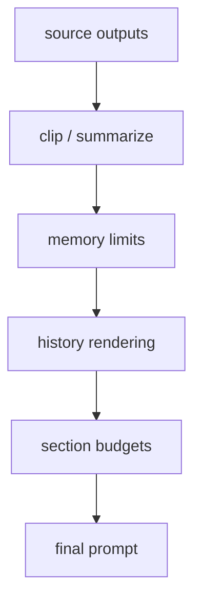

## 背景
问题从 prompt 能不能拼出来，变成了长链路任务里系统怎么把真正有用的上下文留下来。

代码任务一旦进入多轮循环，最先膨胀起来的通常不是用户输入，往往是别的东西：

+ 工具输出
+ 文件内容
+ shell 日志
+ 历史记录
+ 相关记忆

这些内容有个共同点，都可能很长，而且价值分布很不均匀。有些内容对下一步很关键，有些只是调查过程里的副产品。如果系统不做控制，提示词很快就会被旧历史、长日志和重复信息占满。

这里主要给大家讲`Pico` 怎么把上下文瘦身做成一条分层机制。

## 这篇要解决什么问题
问题可以压成一句话：

**当 agent 在一轮任务里不断读文件、跑命令、积累历史时，runtime 怎么把最有用的上下文继续送给模型，又不让 prompt 被撑爆。**

这里真正要回答的是四件事：

+ 长输出最早在哪一层就开始收
+ history 和 relevant memory 怎么被压缩
+ 最终 prompt 超预算时，谁先让位
+ 这套规则为什么比粗暴截断更稳

## 为什么不能靠粗暴截断
从工程角度看，粗暴截断的问题不在于它简单，而在于它不知道自己切掉的是什么。

代码仓库 agent 的上下文里，有些东西硬度很高：

+ 当前用户请求
+ 系统规则
+ 仓库基线

有些东西可以压缩：

+ 相关记忆
+ 旧历史
+ 重复读取
+ 长日志

如果不分层，直接对整段 prompt 一刀切，结果经常会变成最该保留的东西被一起切坏。尤其是当前请求，一旦失真，后面所有优化都没意义。

`Pico` 这里的判断很明确，不走一把大剪刀，而是把瘦身拆成几层。

## Pico 现在是怎么做上下文瘦身的
当前这套机制可以拆成四层。

1. 长命令输出先保存运行工件，再裁成预览
2. 记忆层先做限额
3. 历史按新旧分层压缩
4. 最后按 section 预算再做一轮收缩



瘦身不只发生在 `ContextManager.build()` 里。很多长内容一进系统就已经开始被收了。

## 第一层，长输出先在入口处收
`Pico` 的第一道闸门，不在 prompt 组装阶段，而在内容刚进入系统的时候。

`pico/workspace.py` 里有一个通用的 `clip()`：

```python
def clip(text, limit=MAX_TOOL_OUTPUT):
    text = str(text)
    if len(text) <= limit:
        return text
    return text[:limit] + f"\n...[truncated {len(text) - limit} chars]"
```

默认上限是 `MAX_TOOL_OUTPUT = 4000`。这意味着超长工具结果不会在系统内部无限流动。

当前这层裁剪至少出现在这些地方：

| 场景 | 上限 |
| --- | --- |
| 工具返回值统一裁剪 | 4000 |
| 长命令结果正文预览（另附状态和引用） | 480 |
| 工作区文档片段 | 1200 |
| `git status --short` | 1500 |
| trace 里的工具结果摘要 | 500 |
| `run_started` 里的用户请求摘要 | 300 |

### Phase 2 的长命令日志

`tools.py` 中的 `run_shell` 用 `subprocess.run()` 采集 stdout、stderr 和退出码。结果进入 `ToolExecutor` 时，通用的 4,000 字符 `clip()` 是原先首次按长度截断的位置。在 `ask()` 中执行的命令结果超过该阈值时，执行器先按运行工件规则脱敏，再写入 `.pico/runs/<run_id>/tool_outputs/<id>.log`。每份工件独立限制为 256 KiB UTF-8 字节，超限时保留首尾并在中间写入省略标记，引用同时标为 `truncated`。

history 保存命令参数、执行状态、短预览以及工件相对路径和行数。Agent 可以在当前权限下通过 `read_file` 按行读回，超长单行可用 `start_column` 从指定列继续。恢复到新 run 时，旧引用仍指向产生日志的 run 目录。旧工件缺失时，读工具明确返回 `file not found`。


除此之外，还有一层更细的压缩，`summarize_read_result()` 会把 `read_file` 的结果压成一句很短的摘要：

```python
summary = " | ".join(lines[:3])
return clip(summary, limit)
```

这一步的作用很直接，不让完整文件内容直接冲进长期上下文。

## 第二层，memory 自己先限额
`06` 这一章不展开记忆设计细节，但它和瘦身是绑在一起的，所以这里必须提。

`pico/features/memory.py` 里现在有几组硬上限：

+ `WORKING_FILE_LIMIT = 8`
+ `EPISODIC_NOTE_LIMIT = 12`
+ `FILE_SUMMARY_LIMIT = 6`

文本本身也会先裁长度：

+ `task_summary` 裁到 300
+ `episodic note` 裁到 500
+ `file summary` 裁到 500

这层设计解决的是一个很实际的问题，记忆自己不能先长成第二份历史。它得保持小，才能真的帮下一轮做事。

## 第三层，Relevant memory 不全带，只带少量
到了 `ContextManager.build(user_message)`，相关记忆会先被召回，再被预算控制。

现在默认只召回 top 3：

```python
selected_notes = self.agent.memory.retrieval_candidates(
    user_message,
    limit=RELEVANT_MEMORY_LIMIT,
)
```

`RELEVANT_MEMORY_LIMIT` 当前是 `3`。这里还有一个很实用的设计，每条 note 会平分这一段预算，不让一条超长笔记把其他笔记都挤掉。

代码在 `_render_relevant_memory()`：

```python
per_note_budget = self._per_note_budget(budget, len(note_texts), header)
rendered_notes = [_tail_clip(text, per_note_budget) for text in note_texts]
```

这一步说明两件事。

+ 相关记忆不会全带
+ 带进去的几条也会继续被压短

## 第四层，history 按新旧分层
`ContextManager(agent, history_strategy="dynamic")` 默认启用动态窗口。`history_strategy="fixed"` 将最近窗口固定为最后 6 条历史事件，更早的事件仍可用短表示回填。这是 `ContextManager` 的配置项。

动态窗口从最新事件向前选取，计算完整渲染的字符数，包含 `Transcript:` 标题和换行。遇到首条放不下的事件时，先尝试该事件的短表示，再用剩余预算回填更早的历史。固定窗口在最后 6 条里逐条尝试完整表示、短表示和省略，再回填更早的历史。两种策略最终都按时间顺序输出。总预算收缩到 `history` 时，会用收缩后的分区预算重新选取。

普通消息的短表示最多保留 60 个正文字符。工具名、参数和结果一起参与取舍。完整表示保留调用行和结果，短表示在一条记录里保留工具名、参数预览和结果预览，整条最多 180 字符。结果预览取前 3 个非空行，可按剩余空间缩短。空间装不下两部分预览时，整条省略。旧的 `read_file` 按路径折叠，同组以最新的一条为代表，有记忆摘要时用它作为结果预览。

带工件的命令事件缩成短表示时，将结果部分换成执行状态和完整的工件引用。引用和参数预览一起参与预算取舍。五段 prompt 的顺序和动态窗口规则沿用 Phase 1。

这些操作只影响 prompt 中的历史呈现，session 原始记录保留。关闭 `context_reduction` 时，历史使用 `unreduced` 策略呈现。

`prompt_metadata.history` 同时出现在 `prompt_built` trace 中。它区分 `budget_chars`（生效的分区预算）和 `rendered_chars`（实际占用），并记录 `strategy`、`retained_count`、`recent_count`、`shortened_entries` 和 `omitted_entries`。缩短和省略用当轮 session 历史的零基索引和原因标识。固定策略的 `recent_count` 包含固定窗口里用短表示保留的事件，动态策略的该字段统计完整保留的近期事件。

## 最后一层，section 预算控制
上下文真的装箱，发生在 `ContextManager.build()`。

当前 prompt 的 section 顺序是固定的：

1. `prefix`
2. `memory`
3. `relevant_memory`
4. `history`
5. `current_request`

默认预算也是固定的：

| 部分 | 默认预算 |
| --- | --- |
| `prefix` | 3600 |
| `memory` | 1600 |
| `relevant_memory` | 1200 |
| `history` | 5200 |
| `current_request` | 不裁剪 |


默认总预算目标为 12000 字符。预算和实占都按 Python 字符串长度计算。Token 估算和服务端 token 实测属于后续阶段。

如果超预算，系统不会对整段 prompt 一刀切，而是按固定顺序收：

```python
DEFAULT_REDUCTION_ORDER = ("relevant_memory", "history", "memory", "prefix")
```

这条顺序很有代表性。平台已经把谁先让位写死了。

+ 先让 `relevant_memory` 收
+ 再让 `history` 收
+ 再动 `memory`
+ 最后才动 `prefix`

`current_request` 根本不进裁剪流程，它一直原样保留。

这就是 `Pico` 在上下文治理里的核心判断，**<font style="color:#DF2A3F;">用户当前这句话最硬，不能失真</font>**。

## floor 现在怎么生效
`pico/context_manager.py` 里虽然定义了 `DEFAULT_SECTION_FLOORS`，但默认运行时用的 floor 计算来自 `_compute_section_floors()`：

```python
floors = {
    section: max(20, int(budget) // 4)
    for section, budget in self.section_budgets.items()
}
```

也就是说，默认情况下，每个 section 最低会被压到自身预算的四分之一，除非显式传 `section_floors` 去覆盖。

## 这一层的设计怎么被验证
### 第一类是行为测试
`tests/test_context_manager.py` 覆盖动态窗口超过 6 条、长工具事件完整保留／缩短／整体省略、旧读取折叠、总预算收缩后重新选取、请求原文、session 原始历史和 trace 元数据。

### Phase 1 确定性重放

在仓库根目录执行 `python scripts/replay_history_windows.py --with-baseline`。脚本从 Git 读取改动前的 `ffd3de0`，以相同输入、720 字符的 history 预算和 12000 字符的总预算分别重放旧版固定、新版固定和新版动态三组。输出包括完整 transcript 和裁剪明细。新版固定与新版动态共用渲染规则，两者的配置只切换窗口策略。表中的数字为零基历史索引。

| 场景 | 策略 | 近期／保留条数 | 实占字符 | 缩短 | 省略 |
| --- | --- | ---: | ---: | --- | --- |
| 密集短消息 | 旧版固定 | 6／10 | 711 | 2–5 | 0–1 |
| 密集短消息 | 新版固定 | 6／9 | 720 | 3–5 | 0–2 |
| 密集短消息 | 新版动态 | 8／8 | 707 | 无 | 0–3 |
| 长工具记录 | 旧版固定 | 5／9 | 663 | 0–3 | 8 |
| 长工具记录 | 新版固定 | 6／8 | 708 | 2、3、8 | 0、1 |
| 长工具记录 | 新版动态 | 1／10 | 720 | 0–8 | 无 |
| 重复读取 | 旧版固定 | 6／7 | 320 | 0 | 1、2 |
| 重复读取 | 新版固定 | 6／7 | 391 | 2 | 0、1 |
| 重复读取 | 新版动态 | 7／8 | 720 | 1 | 0 |

密集短消息中，新版动态完整保留第 4–11 条，新版固定完整保留第 6–11 条，并用余量呈现第 3–5 条的短表示。长工具场景中，旧版省略第 8 条。新版两种策略都保留类似 `[tool:run_shell] {"command": "pytest -q aaa... -> FAIL smoke | bbb...` 的预览。新版动态在长工具前切换到旧历史的短表示，因此还能呈现第 0、1 条。重复读取中，动态窗口保留第 2 条的完整调用和结果，并将仍处于旧历史的第 0、1 条折叠为第 1 条。

以上数字来自脚本化的字符计数。归档中的 `full` 和 `no_context_reduction` 实验比较的是整套上下文裁剪开关，结果单独记录。Phase 1 重放未调用真实模型。

## Phase 4 按需任务摘要与 token 预算

字符预算继续控制各分区的组装。发送前按文本估算 token，`input_tokens_estimated` 的来源标为 `heuristic`。传入 `--context-window-tokens` 后，模型窗口减去 `--max-new-tokens` 得到输入预算，现有裁剪规则同时检查字符目标和 token 上限。窗口未知时沿用字符预算。后端返回的 `input_tokens` 另外标为 `provider`，它只描述已经发送的这次请求。已知窗口且裁剪后估算仍超限时，Pico 记录 `context_window_exceeded` 并结束该次运行。

默认保护最近 6 条历史记录。更早的未覆盖记录达到 `--context-summary-threshold`（默认 12）时，可以触发一次摘要。如果规则裁剪后仍超预算，有可摘要的旧记录就可以提前尝试。摘要调用复用模型的输出上限和请求超时。摘要输入按历史顺序分批，并包含上一版摘要。输入最多 12000 字符，渲染后的摘要最多 1600 字符。设定阈值为 `0` 会停止生成新摘要，已存摘要仍可读。

例如，构建 prompt 时有 18 条历史记录，最近 6 条之外的 12 条达到了默认阈值。如果这 12 条都装进摘要输入，且生成的摘要通过验证并装进历史分区，`context_summary.covered_history_count` 就记为 `12`。后续组装可用摘要呈现前 12 条记录，剩余记录继续按现有规则呈现。保存边界和摘要时保留完整原始历史，恢复会话时可从边界继续处理。

摘要包含任务目标、有效约束、已完成改动、失败尝试、未解决问题、验证结果、文件与日志引用和下一步。Phase 3 的活跃任务状态继续提供当前约束和验证证据。摘要超时、为空、格式无效或无法装入 prompt 时，继续使用原有摘要及规则裁剪。失败范围和当时的可摘要边界用来抑制同段重试。`context_summary_saved` 和 `context_summary_failed` 分别记录触发原因、历史范围、耗时、输入估算、可用的后端实测和失败原因。

`tests/test_context_summary.py` 覆盖短会话、阈值触发、近期原文、无新增时的去重、恢复、失败回退和输入超限。

## 面试里怎么讲这一层
> 长命令输出在入口处保存为运行工件，history 只携带预览和引用。记忆层先限制数量和长度，历史记录按新旧分层，最后由 `ContextManager` 按分区预算收缩。超预算时依次裁剪 `relevant_memory`、`history`、`memory` 和 `prefix`。`current_request` 始终完整保留。
>

## 总结
`Pico` 的这一层设计，核心是把上下文瘦身做成一条分层机制。

长输出先在入口收，memory 自己先限额，history 按新旧分层，最后再做 section 预算控制。这样 prompt 会被收紧，同时结构和当前请求的完整性还在。对一个本地 coding harness 来说，这比单纯塞更多上下文更重要。

