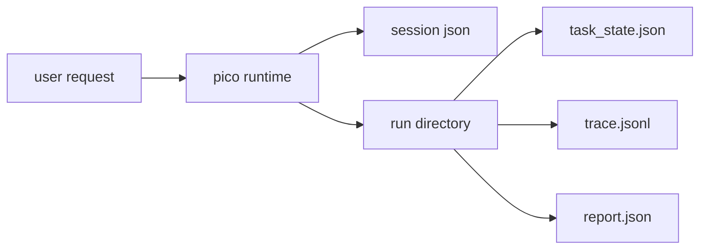

## 背景
本地 code agent 一旦开始处理真实仓库任务，很快就会碰到三件事：

+ 跑到一半中断了，下一次怎么接着来
+ 跑完以后结果不对，怎么回看过程
+ 做 benchmark、做聚合、做面试展开时，证据从哪里拿

这三件事看起来像一类问题，实际上不是同一层。恢复现场需要的是还能继续工作的状态，复盘和审计需要的是可回看的运行证据。`Pico` 这一层做的，就是把这两类东西分开。

## 这篇要解决什么问题
问题可以压成一句话：

**为什么 **`Pico`** 要把会话状态和 run 工件拆成两层，以及这两层各自解决什么问题。**

每次 `ask()` 把运行产物写到 `.pico/runs/<run_id>/`，包括 `task_state.json`、`trace.jsonl`、`report.json`，以及按需保存的长命令日志。

这里真正要回答的是四件事：

+ session 在保存什么
+ run artifact 在保存什么
+ `--resume` 到底恢复了哪一层
+ 为什么 `task_state`、`trace`、`report` 要分开写

如果这几件事讲不清楚，运行状态设计就很容易被看成反正都存成 JSON 了，看不出这层工程取舍。

## Pico 为什么要分两层
`Pico` 现在把运行状态分成两层。

+ 第一层是 session
+ 第二层是 run artifact

session 回答的是，以后还能不能继续干。  
run artifact 回答的是，刚才到底发生了什么。



这张图里最重要的点就一句话，session 和 run artifact 虽然都在存状态，但回答的不是同一个问题。

## session 这一层在存什么
session 由 `pico/session_store.py` 的 `SessionStore` 持久化。

路径很简单：

```latex
.pico/sessions/<session_id>.json
```

这个 JSON 里现在最关键的字段有这些：

| 字段 | 作用 |
| --- | --- |
| `id` | 会话 id |
| `created_at` | 会话创建时间 |
| `workspace_root` | 当前工作区根目录 |
| `history` | 完整会话记录 |
| `memory` | 工作记忆，含最新请求的截短文本 `working.task_summary`、近期文件、文件摘要与笔记 |
| `task_context` | 跨轮目标、有效约束、未解决错误、最近验证和文件修改，含来源及相关日志引用 |
| `checkpoints` | 具名检查点及其父链接，保存当时的任务状态、恢复提示、运行时身份和关键文件指纹 |


也就是说，session 里保存的是下一轮继续工作还会用到的状态。

`pico/session_store.py` 的 `SessionStore` 先把快照写到同目录的临时文件，再替换会话 JSON。history 事件和引用该事件的任务证据随同一份快照发布。

这层没有数据库，也没有复杂索引。对 `Pico` 这个体量来说，这个取舍很实际，先把恢复做直接，比先把存储做复杂更重要。

## run artifact 这一层在存什么
每次 `ask()`，`RunStore.start_run()` 都会创建一个 run 目录：

```latex
.pico/runs/<run_id>/
```

| 文件 | 作用 |
| --- | --- |
| `task_state.json` | 当前这轮运行的状态快照 |
| `trace.jsonl` | 运行过程中的逐事件时间线 |
| `report.json` | 这轮结束后的聚合摘要 |
| `tool_outputs/<id>.log` | 超过通用结果裁剪阈值的脱敏命令日志 |

### 长命令日志与恢复

比如一条测试命令输出了上千行，报错在最后几行。下次继续会话时，Agent 可以找到旧日志，直接读末尾那几行。

**日志怎么存，怎么找**

1. **保存日志。** 命令跑完后，Pico 会遮掉长输出中识别到的敏感值，再把日志保存到本次运行的 `.pico/runs/<run_id>/tool_outputs/` 目录。
2. **在历史里留个入口。** 会话历史保留命令、执行状态、短预览和日志引用（`artifact`）。引用里写着文件路径、保存后的行数，以及日志是否被截断。
3. **恢复会话后读旧日志。** 新一轮运行有自己的目录。旧引用依然指向产生日志的那一轮。当前运行允许使用 `read_file` 时，Agent 可以用旧路径读取指定的几行。

工具执行记录（`tool_executed`）也会保存这份引用。任务状态里的错误和验证结果可以沿用它来定位证据。

**遇到这些情况怎么办**

- **一行太长。** 用 `start_column` 指定从这一行的第几列继续读。
- **路径指向工作区外。** Pico 会检查路径的最终位置并拒绝读取。
- **日志超过 256 KiB。** Pico 保留开头和结尾，并在中间标出省略的位置。
- **日志保存失败。** 历史保留执行状态和预览，并提示 `artifact unavailable (save failed)`。
- **旧日志被删了。** 读取时会提示 `file not found`，历史里的预览仍可查看。
- **迁移会话。** 一起带走旧日志目录，保持它在工作区里的相对位置，原引用就能继续使用。

对应代码在 `pico/run_store.py`：

```python
def task_state_path(self, run_id):
    return self.run_dir(run_id) / "task_state.json"

def trace_path(self, run_id):
    return self.run_dir(run_id) / "trace.jsonl"

def report_path(self, run_id):
    return self.run_dir(run_id) / "report.json"
```

这一层和 session 的区别很清楚，run artifact 负责的是审计、回放和聚合。

## 为什么每次 ask() 都要新开一个 run
`Pico.ask()` 一开始就会创建：

+ 一个新的 `TaskState`
+ 一个新的 `run_id`
+ 一个新的 run 目录

主线在 `pico/runtime.py`：

```python
task_state = TaskState.create(
    run_id=self.new_run_id(),
    task_id=self.new_task_id(),
    user_request=user_message,
)
self.current_task_state = task_state
self.current_run_dir = self.run_store.start_run(task_state)
```

这一步很值，因为它把一次用户请求和一组独立工件绑定死了。

后面你做排查、看 trace、聚合 metrics，都不需要再从一整个会话里猜边界。run 的边界在文件系统上就是独立的。

## task_state 为什么是快照
`pico/task_state.py` 里的 `TaskState` 保存的是这轮运行此刻的中心状态。

当前关键字段有这些：

+ `status`
+ `tool_steps`
+ `attempts`
+ `last_tool`
+ `stop_reason`
+ `final_answer`

它的职责是回答现在这轮跑到哪了。跨轮证据由同一模块的 `TaskContext` 管理，最新版本写入 session，checkpoint 保存触发时的独立快照。来源中的 `history_index` 从零开始，工具来源还包含 `run_id` 和 `tool_step`，可以回查原始会话事件和运行 trace。

比如：

+ `attempts` 记录模型已经被调了多少轮
+ `tool_steps` 记录真正执行了多少步工具
+ `stop_reason` 记录最后为什么停
+ `final_answer` 记录最后答案

这就是为什么 `task_state.json` 更像快照，不像日志。

你想先知道这轮为什么停，先看它就够了。

## trace 为什么要单独用 jsonl
`RunStore.append_trace()` 现在是 JSONL 逐条追加，不是最后一次性写整份 trace。

```python
with path.open("a", encoding="utf-8") as handle:
    handle.write(json.dumps(event, sort_keys=True, ensure_ascii=True))
    handle.write("\n")
```

这个做法很朴素，但很适合 agent 运行过程。

因为 trace 天生就是事件流，比如：

+ `run_started`
+ `prompt_built`
+ `model_requested`
+ `model_parsed`
+ `tool_executed`
+ `run_finished`

这类数据按 JSONL 写有几个好处：

+ 运行中就能持续落盘
+ 中途异常时，不容易整份 trace 都没了
+ 后面做聚合时，顺着事件扫就行

所以 trace 这层负责回答的是，过程里发生过什么。

## report 为什么还要单独写一份
有了 `task_state` 和 `trace`，为什么还要再写 `report.json`？

因为前两者都更像原材料。

+ `task_state` 适合看当前状态
+ `trace` 适合看过程细节

真正做聚合、benchmark、resume metrics 时，更顺手的是一份已经收过的结果摘要。

`build_report()` 当前会把这些关键字段写进去：

+ `run_id`
+ `task_id`
+ `status`
+ `stop_reason`
+ `final_answer`
+ `tool_steps`
+ `attempts`
+ `task_state`
+ `prompt_metadata`

代码在 `pico/runtime.py`：

```python
return {
    "run_id": task_state.run_id,
    "task_id": task_state.task_id,
    "status": task_state.status,
    "stop_reason": task_state.stop_reason,
    "final_answer": task_state.final_answer,
    "tool_steps": task_state.tool_steps,
    "attempts": task_state.attempts,
    "task_state": task_state.to_dict(),
    "prompt_metadata": self.last_prompt_metadata,
}
```

所以 `report` 这层更像给聚合脚本和实验统计准备的成品层。

## resume 到底恢复了什么
恢复走的是 `Pico.from_session()`，CLI 则通过：

+ `--resume <session_id>`
+ `--resume latest`

把这个入口接起来。

`build_agent()` 里的逻辑是：

```python
session_id = args.resume
if session_id == "latest":
    session_id = store.latest()
if session_id:
    return Pico.from_session(...)
```

这里有个点很重要，恢复的时候做的是下面这几件事：

+ 重新构造新的 `Pico`
+ 重新注入当前 `model_client`
+ 重新注入当前 `workspace`
+ 把旧的 `session` 状态读回来

也就是说，resume 恢复的是会话状态，不是进程本身。

**恢复时从哪里读取任务状态**

1. **先读会话里的最新任务状态。** Pico 会随用户消息和工具结果保存这份状态。
2. **缺失时读 checkpoint。** 如果兼容的 checkpoint 保存了任务状态，就用它来恢复。
3. **更早的会话从用户历史重建。** Pico 找回用户明确提出的目标和约束。历史里缺少目标时，可以用兼容 checkpoint 中的目标。旧工具输出仍保留在历史里。

**以修复检查脚本为例**

1. **记录目标和报错。** 用户说“修复检查脚本。不要修改公共 API。”检查命令失败后，Pico 保留未解决的错误和长日志引用。
2. **恢复后接着做。** 用户输入“继续”，`task_summary` 更新为“继续”。prompt 的 `memory` 仍优先呈现原目标、API 约束、未解决的错误和日志引用。
3. **按新指令更新约束。** 用户后来明确允许修改公共 API，Pico 就更新对应的约束。
4. **验证通过后移出旧错误。** 同一条检查命令以退出码 0 结束后，旧错误从优先展示的内容中移除。成功的验证记录会关联到原来的失败记录。
5. **文件变动后重新确认。** 文件被外部编辑后，Pico 会提示重跑受影响的检查，并提醒 Agent 重新读取旧记录已过期的文件。

## 这一层现在怎么被验证
### 第一类是 run store 行为测试
`tests/test_run_store.py` 现在已经覆盖了：

+ `start_run()` 会创建 run 目录和 `task_state.json`
+ `append_trace()` 会按 JSONL 追加事件
+ `write_report()` 会写出 `report.json`
+ 缺失最终 report 的 run 目录也能被容忍

### 第二类是运行闭环测试
`tests/test_pico.py` 现在已经覆盖了：

+ 一次 `ask()` 结束后会留下 `task_state.json`、`trace.jsonl`、`report.json`
+ `task_id` 和 `run_id` 会分开
+ `run_finished` 会出现在 trace 里
+ secret 会在 trace 和 report 里被脱敏
+ session 可以被保存再恢复

也就是说，这层状态闭环现在不是只停在设计图上，代码和测试都已经把关键行为钉住了。

## 这一层现在没做什么
+ session 还是单文件 JSON，没有更复杂索引
+ session 和 run 的关联关系还比较自然，没有单独抽一层索引
+ run artifact 还没有 schema version
+ 文件指纹覆盖本地工作区文件，验证仍可能受外部依赖和运行环境影响

这些都不是 bug，更像后续可以继续往前走的点。

## 如果继续往下做，优先怎么补
我会优先补三件事。

### 一，给 run artifact 加 schema version
benchmark 这边已经有版本意识了。后面如果 trace 和 report 结构会继续演进，run artifact 也值得单独带版本。

### 二，把 session 和 run 的关系再写得更显式
现在已经能串起来，但如果以后要做跨会话分析，关联字段可以更明确一点。

### 三，给 resume 加更多一致性检查
如果后面 workspace 和 memory 结构变复杂，恢复时多做几项一致性检查会更稳。

## 面试里怎么讲这一层
> Pico 这里把运行状态拆成了两层。session 负责保存还能继续工作的状态，比如 history 和 memory；run artifact 负责保存刚才这轮到底发生了什么，所以每次 `ask()` 都会单独写出 `task_state.json`、`trace.jsonl` 和 `report.json`。`task_state` 负责看现在跑到哪了，`trace` 负责看过程里发生了什么，`report` 负责给后面的聚合和实验统计提供摘要。这样恢复和复盘就不会混在一起，agent 也不只是当场跑完就结束。
>

## 总结
`Pico` 的这一层设计，核心是把还能继续工作的状态和能回看的证据分开。

session 负责延续会话，run artifact 负责记录单轮执行。这样一来，agent 不只会跑，也更容易恢复、更容易复盘、更容易拿去做 benchmark 和面试展开。

