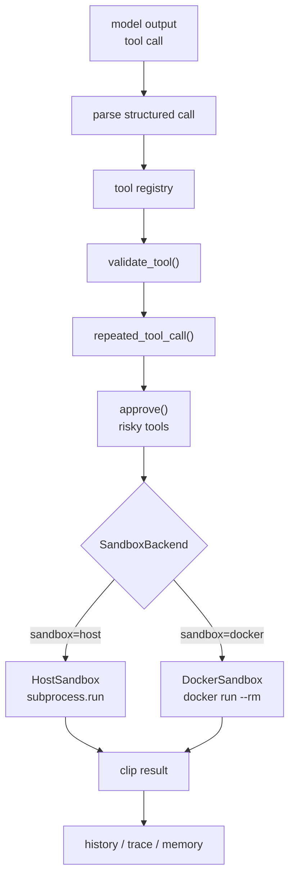
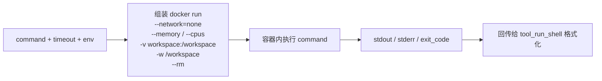

# 03 Docker 沙箱接入 —— 需要改动的点

> **文档生成时间**：2026-08-09
>
> 配套文档：`03-工具的接入与调用设计 (2).md`、`归档/解释/沙箱概念说明.md`
>
> 目标：把 `run_shell` 从宿主机 `subprocess.run(shell=True)` 换成可选的 Docker 执行后端；现有校验 / 审批 / trace 链尽量不动。

---

## 一、现状与缺口

当前 `tool_run_shell()`（`pico/tools.py`）直接在宿主机执行：

```python
subprocess.run(
    command,
    cwd=context.root,
    shell=True,
    env=context.shell_env(),
    timeout=timeout,
    ...
)
```

已有约束：`cwd=root`、env allowlist、timeout、审批。  
缺口：无文件系统 / 网络 / 进程级隔离；危险命令仍可能伤到宿主。

---

## 二、接入后的执行链（流程图）

护栏仍在宿主机侧；真正执行才进 Docker。



Docker 分支内部大致是：



和「现在」的对比：

| 阶段 | 现在 | 有 Docker 之后 |
|------|------|----------------|
| 校验 / 重复 / 审批 | 宿主机 `ToolExecutor` | **不变** |
| `run_shell` 真正执行 | 宿主机 shell | `HostSandbox` 或 `DockerSandbox` |
| 文件工具 read/write/patch | 宿主机路径 | 第一期可先不变 |
| env allowlist | 过滤后传给子进程 | 继续传给容器（仍不带 API key） |

---

## 三、需要改动的代码点

### 1. 必改（第一期：只沙箱化 `run_shell`）

| 文件 | 改动 | 说明 |
|------|------|------|
| **新建** `pico/sandbox.py`（或 `pico/sandbox/`） | 新增 `SandboxBackend` 协议；实现 `HostSandbox`、`DockerSandbox` | 核心新增。`run(command, *, cwd, env, timeout) -> CompletedProcess` 一类接口 |
| `pico/tools.py` | `tool_run_shell()` 去掉直接 `subprocess.run`，改为 `context.sandbox.run(...)` | 执行点唯一替换处 |
| `pico/tool_context.py` | `ToolContext` 增加 `sandbox` 字段 | 工具函数只拿窄上下文，不直接碰 runtime |
| `pico/runtime.py` | `__init__` 增加 sandbox 配置；构造 backend；`tool_context()` 注入；`spawn_delegate()` 把同一 sandbox 配置传给子 agent | 接线与生命周期 |
| `pico/cli.py` | 增加例如 `--sandbox {host,docker}`、`--sandbox-image` | 用户可切换，默认可先 `host` 保持兼容 |

建议的 Docker 默认参数（实现时写进 `DockerSandbox`）：

+ `--rm`：跑完销毁
+ `--network=none`：默认禁网
+ 资源上限：`--memory`、`--cpus`、`--pids-limit`
+ 挂载：只挂 `workspace` → `/workspace`，`-w /workspace`
+ 非 root / 无 `--privileged`
+ 超时：沿用工具 `timeout`，超时后 `docker kill`

### 2. 建议同步改（配置可观测）

| 文件 | 改动 | 说明 |
|------|------|------|
| `pico/runtime.py` → `DEFAULT_FEATURE_FLAGS` | 可选增加 `"docker_sandbox": False` | 与现有 feature flag 风格一致 |
| `pico/checkpoint.py` | `RUNTIME_IDENTITY_KEYS` / `current_runtime_identity()` 记入 sandbox 模式与 image | resume 时能发现执行环境变了 |
| `pico/prompt_prefix.py` | 若启用 Docker，可在工具说明里提一句「shell 在容器内执行」 | 降低模型对宿主路径的错误假设 |

### 3. 第一期先不动

| 文件 / 能力 | 原因 |
|-------------|------|
| `tool_write_file` / `tool_patch_file` / `tool_read_file` / `tool_search` | 仍走宿主机工作区；第二期再统一进容器视图 |
| `tool_executor.py` | 护栏顺序不变，只消费工具返回文本 / metadata |
| `runtime.path()` | 路径边界继续有效；Docker 是额外隔离层 |
| `security.shell_env()` | allowlist 继续用，容器也不该继承宿主密钥 |

### 4. 测试要补

| 文件 | 补什么 |
|------|--------|
| **新建** `tests/test_sandbox.py` | host/docker 切换；`DockerSandbox` 组装的 `docker run` 参数（mock CLI）；超时与输出格式 |
| `tests/test_safety_invariants.py` | Docker 模式下：读宿主敏感路径失败 / 外网不可达（可 mock）；env 仍不泄漏 |
| `tests/test_pico.py` | 现有 `run_shell` 相关用例在 `sandbox=host` 下保持绿 |

单测不要强依赖本机 Docker daemon；对 `docker` 子进程做 mock 即可。

---

## 四、推荐改动顺序

```text
1. 抽出 SandboxBackend + HostSandbox（行为与今天完全一致）
2. tool_run_shell / ToolContext / runtime 接线，默认 host
3. 实现 DockerSandbox + CLI 开关
4. 补测试与安全场景
5.（可选第二期）write/patch 与 workspace 一并进容器
```

这样每一步都可回滚：没装 Docker 时继续用 `host`。

---

## 五、第二期（可选）再动什么

若要做到「改世界的动作都在笼子里」：

1. workspace 以 volume 或 copy-on-write 进容器  
2. `write_file` / `patch_file` 也通过同一 sandbox 视图写入  
3. 任务结束策略：丢弃容器，或只把允许的 diff 写回宿主机  
4. `read_only` / `delegate` 子 agent：容器内只读挂载

第一期不要求一次做完；先堵住 `run_shell` 的爆炸半径已经有明显收益。

---

## 六、一句话总结

+ **必改**：新建 sandbox 模块，改 `tools.py` 执行点，改 `tool_context.py` / `runtime.py` / `cli.py` 接线。  
+ **不变**：`ToolExecutor` 护栏链、参数校验、审批、trace/memory 回写。  
+ **流程**：模型调用 → 校验/重复/审批 → **SandboxBackend** → Host 或 Docker → 裁剪结果回写。
)
